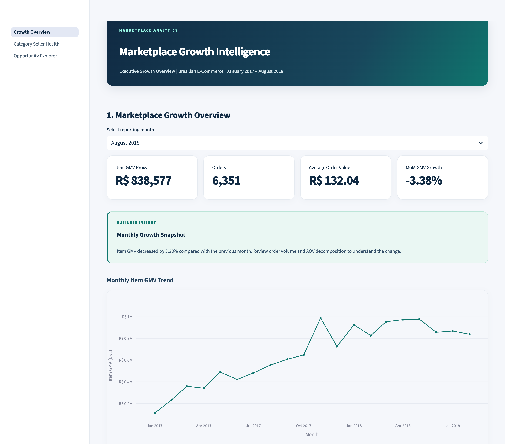
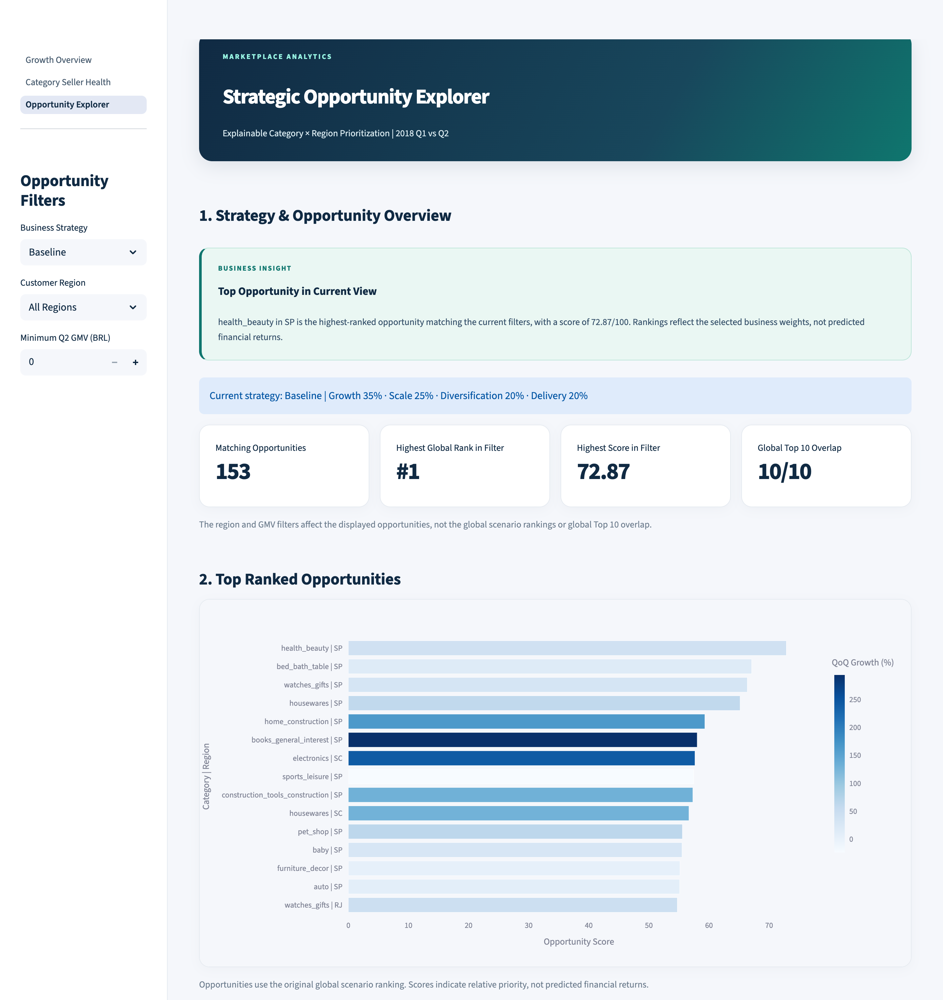
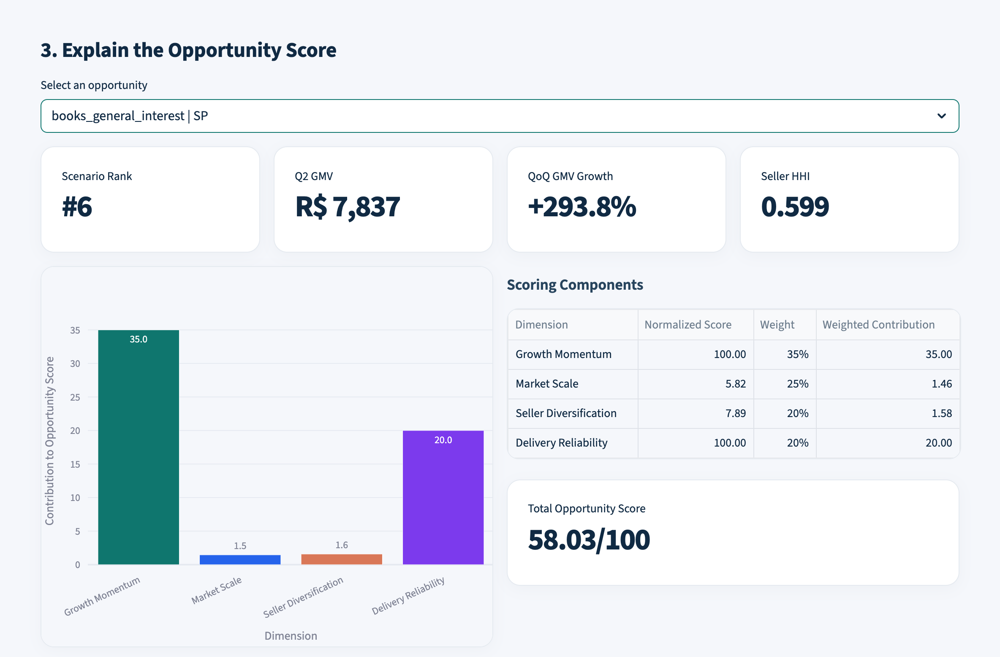
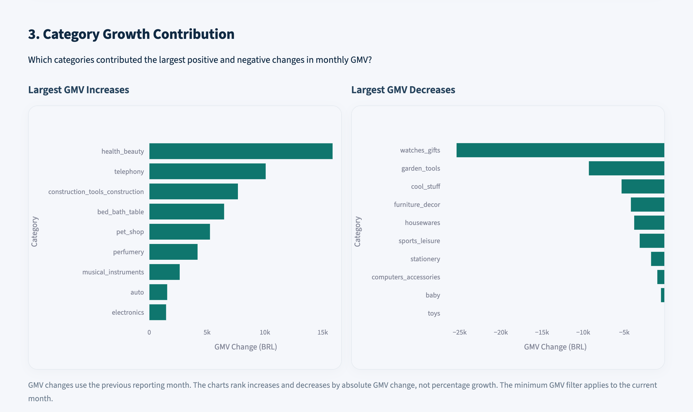
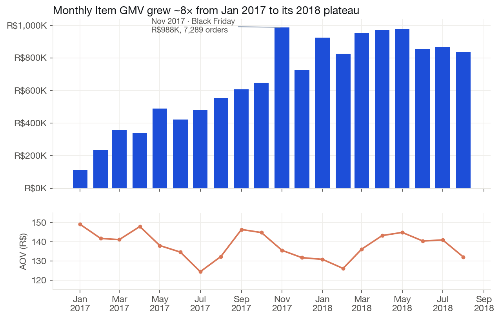
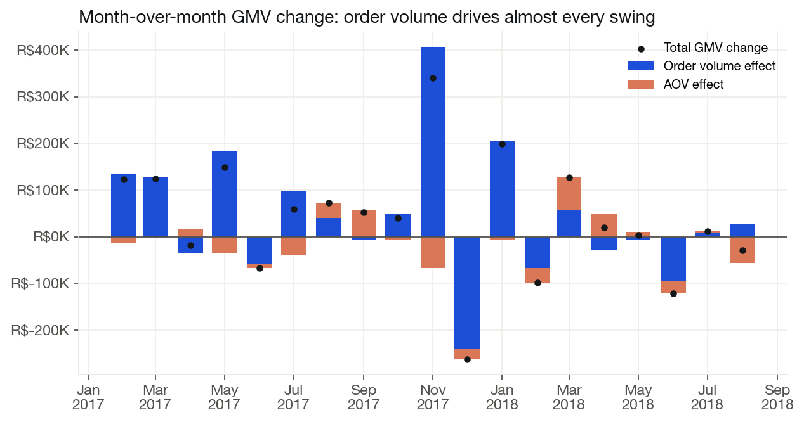
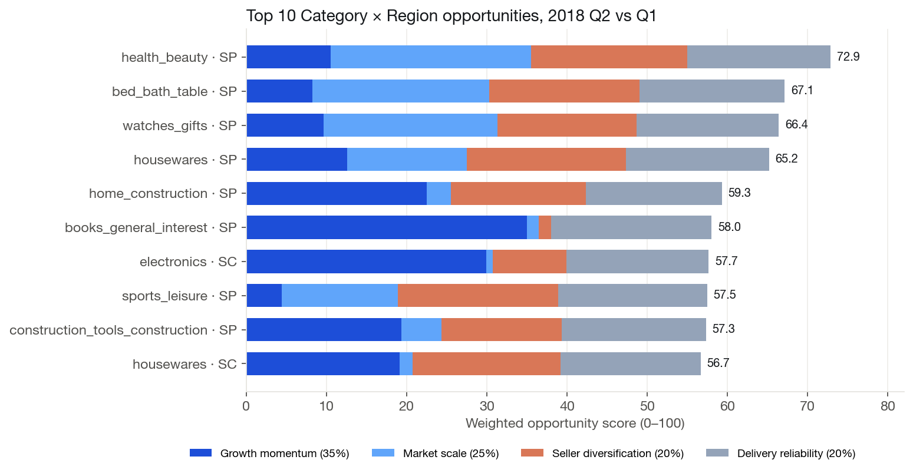
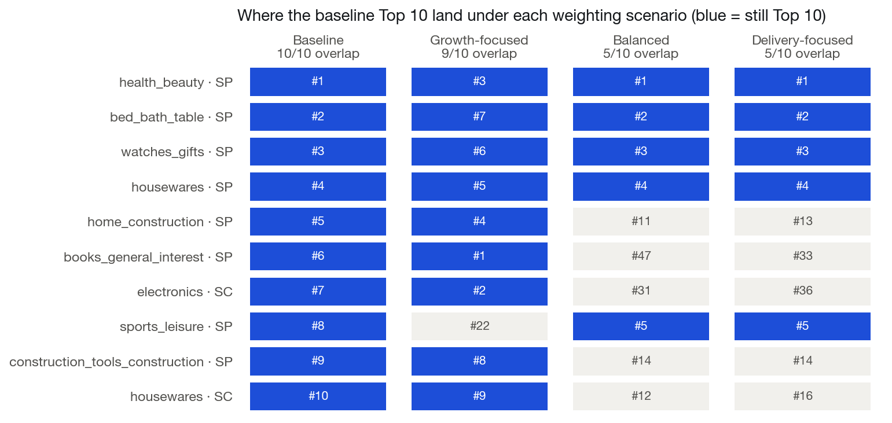

# Marketplace Growth Intelligence & Strategic Opportunity Engine

### PostgreSQL · Python · Streamlit · Plotly

**Project write-up:** [rsm-hstseng.github.io/projects/project6](https://rsm-hstseng.github.io/projects/project6/)

An end-to-end Business Intelligence project that transforms historical Brazilian e-commerce transactions into actionable marketplace growth insights and explainable category-region opportunity rankings.

## Project Overview

Marketplace leaders need to understand not only whether GMV is growing, but also what drives that growth, which categories contribute the most, and where seller concentration or operational performance could affect expansion decisions.

This project builds an analytical pipeline and interactive BI dashboard to address those questions using the Olist Brazilian E-Commerce Public Dataset.

**Dataset:** Olist Brazilian E-Commerce Public Dataset
**Analysis Period:** January 2017 – August 2018
**Opportunity Comparison:** 2018 Q1 vs. Q2
**Primary Metric:** Delivered-order Item GMV Proxy (excluding freight)

## Business Questions

1. How much marketplace growth comes from order volume versus Average Order Value?
2. Which product categories contribute most to changes in GMV?
3. Which categories exhibit high seller concentration?
4. Which Category × Region combinations warrant further commercial investigation?
5. How stable are opportunity rankings under different strategic priorities?

## Architecture

The analytical pipeline follows five layers:

```text
Olist CSV Files
      |
      v
PostgreSQL RAW
      |
      v
STAGING VIEWS
      |
      v
CORE FACTS & DIMENSIONS
      |
      v
ANALYTICS MARTS
      |
      v
STREAMLIT DASHBOARD
```

### Core Models

| Model | Grain |
|---|---|
| `core.fct_orders` | One row per order |
| `core.fct_order_items` | One row per order item |
| `core.dim_products` | One row per product |
| `core.dim_customers` | One row per customer record |
| `core.dim_sellers` | One row per seller |

Fact and dimension models are designed to prevent inflated GMV caused by one-to-many joins.

## Analytics Modules

### 1. Marketplace Growth Overview

- Monthly Item GMV
- Order Count
- Average Order Value
- Month-over-Month Growth
- Volume vs. AOV Growth Decomposition

### 2. Category & Seller Health

- Category GMV Performance
- Category Growth Contribution
- Active Sellers
- Seller Concentration (HHI)
- Top Seller GMV Share

### 3. Strategic Opportunity Explorer

A transparent, weighted scoring framework ranks eligible Category × Region combinations.

| Scoring Component | Baseline Weight |
|---|---:|
| Growth Momentum | 35% |
| Market Scale | 25% |
| Seller Diversification | 20% |
| Delivery Reliability | 20% |

The model uses business-defined eligibility thresholds and normalized component scores.

Scores represent relative priorities rather than revenue or profit forecasts.

## Key Findings

### Opportunity Ranking

- 153 Category × Region combinations met the initial eligibility rules.
- Scores ranged from 24.99 to 72.87.
- No invalid scores or duplicate category-region pairs were identified.

### Ranking Sensitivity

Alternative weighting scenarios were evaluated to test how strongly strategic assumptions affect the Top 10 opportunities.

| Scenario | Top 10 Overlap with Baseline |
|---|---:|
| Baseline | 10/10 |
| Growth-focused | 9/10 |
| Balanced | 5/10 |
| Delivery-focused | 5/10 |

**Interpretation:** Top opportunities were relatively stable under the Growth-focused scenario but changed substantially under the Balanced and Delivery-focused scenarios.

Business priorities should therefore be considered explicitly before acting on the ranking.

### Growth Decomposition

Monthly GMV changes were decomposed into order volume and AOV effects.

- 19 comparable months were validated.
- Maximum reconciliation difference: 0.000000.

## Dashboard

The Streamlit application contains three interactive pages:

**Page 1 — Growth Overview**
Monthly KPIs, trends, and growth decomposition.

**Page 2 — Category & Seller Health**
Category contributions, seller concentration, and category performance.

**Page 3 — Opportunity Explorer**
Strategy selection, ranked opportunities, score explanations, ranking stability, and CSV export.

### Screenshots

**Growth Overview**: monthly KPIs, insight and GMV trend


**Opportunity Explorer**: strategy filters and ranked Category × Region opportunities


**Score explanation**: books_general_interest × SP gets almost all of its score from growth momentum


**Category & Seller Health**: largest month-over-month GMV increases and decreases


### Key Charts






## Data Quality & Validation

Validation procedures include:

- Raw-to-Staging row-count checks
- Fact and Dimension grain validation
- Key uniqueness checks
- GMV reconciliation across analytical layers
- Month coverage verification
- Growth decomposition reconciliation
- Opportunity score and eligibility validation
- Scenario sensitivity checks

See [Data Quality Validation Report](docs/validation/validation_summary.md).

## Performance Optimization

The initial Opportunity Ranking query required more than 10 minutes to execute.

Performance improvements included:

- Simplifying staging order transformations after uniqueness checks
- Materializing the shared analytical base dataset
- Creating supporting indexes
- Reusing precomputed opportunity results for sensitivity analysis

The ranking subsequently returned successfully. Formal before-and-after query benchmarks have not been collected.

## Technology Stack

- **Database:** PostgreSQL
- **Analytics:** SQL, CTEs, Window Functions, Aggregation
- **Data Modeling:** Fact / Dimension Models
- **Python:** Pandas, SQLAlchemy, psycopg
- **Dashboard:** Streamlit, Plotly
- **Development:** VS Code

## Local Setup

1. Install PostgreSQL and Python.
2. Download the Olist dataset from its original source.
3. Create a local PostgreSQL database named `olist_growth`.
4. Load the CSV data and execute the SQL scripts in dependency order: Raw, Staging, Core, Marts, and Validation.
5. Create a Python virtual environment and install the dependencies:

```bash
python -m venv .venv
source .venv/bin/activate
python -m pip install -r requirements.txt
```

6. Copy `.streamlit/secrets.example.toml` to `.streamlit/secrets.toml` and add local PostgreSQL credentials.
7. Start the Streamlit application:

```bash
python -m streamlit run dashboard/Growth_Overview.py
```

The application requires access to a locally configured PostgreSQL database populated with the analytical models.

## Limitations

- The dataset is historical and does not represent current market conditions.
- Item GMV is not net revenue or profit.
- Delivered-order filtering can introduce selection bias.
- Period boundaries may have incomplete order or delivery coverage.
- Opportunity weights and eligibility thresholds are analyst-defined.
- HHI indicates seller concentration, not proven supply disruption risk.
- Rankings are decision-support outputs, not causal estimates or financial forecasts.
- Materialized views require refreshing when source data changes.

## Future Improvements

- Parameterized scoring weights
- Eligibility-threshold sensitivity analysis
- Automated data quality tests
- Reproducible database initialization scripts
- Query performance benchmarking
- Hosted dashboard or reproducible demo environment

## Data Source

Olist Brazilian E-Commerce Public Dataset, available on Kaggle.

This project is an independent portfolio analysis and is not affiliated with Olist.
